# 📷 Sistem Manajemen Rental Kamera & Alat Fotografi (CLI)

> **Project Akhir (PA) Praktikum Dasar-Dasar Pemrograman Python 2026**  
> *Aplikasi Konsol / CLI Rental Kamera Modular Berbasis Penyimpanan JSON, Sistem Saldo E-Money, dan Multi-Role Access Control*

---

## 📑 Daftar Isi
1. [Judul & Tema Proyek](#-1-judul--tema-proyek)
2. [Anggota Kelompok & Peran](#-2-anggota-kelompok--peran)
3. [Deskripsi & Tujuan Sistem](#-3-deskripsi--tujuan-sistem)
4. [Flowchart Sistem](#-4-flowchart-sistem)
   - [A. Flowchart Alur Program Utama](#a-flowchart-alur-program-utama)
   - [B. Flowchart Dashboard Administrator (CRUD & Monitoring)](#c-flowchart-dashboard-administrator-crud--monitoring)
   - [C. Flowchart Dashboard User (Top Up, Sewa, Invoice, Pengembalian)](#d-flowchart-dashboard-user-top-up-sewa-invoice-pengembalian)
5. [Daftar Fitur per Role](#-5-daftar-fitur-per-role)
   - [Fitur Role Administrator](#-a-role-administrator)
   - [Fitur Role User / Penyewa](#-b-role-user--penyewa)
   - [Fitur Keamanan & Utilitas Sistem](#-c-keamanan--utilitas-sistem-umum)
6. [Struktur Direktori Repositori](#-6-struktur-direktori-repositori)
7. [Akun Pengujian (Default Accounts)](#-7-akun-pengujian-default-accounts)
8. [Panduan Instalasi & Menjalankan](#-8-panduan-instalasi--menjalankan)
9. [Screenshot Output & Penjelasan](#-9-screenshot-output--penjelasan)
   - [1. Menu Utama Aplikasi](#1-menu-utama-aplikasi)
   - [2. Registrasi Akun Pengguna](#2-registrasi-akun-pengguna)
   - [3. Login & Sistem Penguncian (Lockout)](#3-login--sistem-penguncian-lockout)
   - [4. Dashboard Menu Administrator](#4-dashboard-menu-administrator)
   - [5. Katalog Inventaris Kamera (PrettyTable)](#5-katalog-inventaris-kamera-prettytable)
   - [6. Tambah Kamera Baru (Create)](#6-tambah-kamera-baru-create)
   - [7. Ubah Data Kamera (Update)](#7-ubah-data-kamera-update)
   - [8. Hapus Kamera & Proteksi Alat Sedang Disewa (Delete)](#8-hapus-kamera--proteksi-alat-sedang-disewa-delete)
   - [9. Laporan Transaksi Admin](#9-laporan-transaksi-admin)
   - [10. Dashboard Menu User & Saldo Real-Time](#10-dashboard-menu-user--saldo-real-time)
   - [11. Top Up Saldo E-Money](#11-top-up-saldo-e-money)
   - [12. Transaksi Penyewaan Alat](#12-transaksi-penyewaan-alat)
   - [13. Cetak & Ekspor Struk/Invoice (.txt)](#13-cetak--ekspor-strukinvoice-txt)
   - [14. Pengembalian Alat Sewa & Restok Otomatis](#14-pengembalian-alat-sewa--restok-otomatis)
   - [15. Riwayat Transaksi User](#15-riwayat-transaksi-user)
   - [16. Penanganan Interupsi Aman (CTRL+C & CTRL+Z)](#16-penanganan-interupsi-aman-ctrlc--ctrlz)

---

## 📌 1. Judul & Tema Proyek

* **Judul Proyek**: Sistem Manajemen Rental Kamera & Alat Fotografi Berbasis Command Line Interface (CLI)
* **Tema**: Aplikasi Desktop Terminal Terpadu untuk Manajemen Operasional Persewaan Kamera, Pengelolaan Inventaris Peralatan Fotografi (CRUD), Sistem Dompet Digital (*E-Money*), serta Pencatatan & Ekspor Transaksi Otomatis dengan Penyimpanan Berbasis JSON.

---

## 👥 2. Anggota Kelompok & Peran

| No | Nama Lengkap | NIM | Username GitHub | Peran / Modul Tanggung Jawab |
| :-: | :--- | :---: | :---: | :--- |
| 1 | **M. Fairuz Firerza Aliushami** | 2609116062 | [`@itsraizhu`](https://github.com/itsraizhu) | **Project Lead & Main Navigation Flow**<br>Bertanggung jawab atas arsitektur utama program (`main.py`), koordinasi alur navigasi menu, penanganan interupsi input aman, dan modul utilitas sistem (`utils.py`). |
| 2 | **Muhammad Fachri Razabi** | 2609116069 | [`@Fachri2207`](https://github.com/Fachri2207) | **Inventory Management & Admin CRUD Lead**<br>Bertanggung jawab atas modul pengelolaan inventaris kamera (`kamera.py`), validasi integritas data barang, relasi data stok ke `kamera.json`, dan proteksi penghapusan unit. |
| 3 | **Raisha Achdi Febiandika** | 2609116071 | [`@FEBIANDIKA1107`](https://github.com/FEBIANDIKA1107) | **Transaction, Billing & Invoice Lead**<br>Bertanggung jawab atas logika bisnis transaksi peminjaman, sistem dompet digital e-money, mekanisme pengembalian alat, generator invoice, dan ekspor struk fisik (`transaksi.py`, `transaksi.json`, `invoices/`). |
| 4 | **Alya Shofa** | 2609116077 | [`@alyashofaaa15-cloud`](https://github.com/alyashofaaa15-cloud) | **Authentication, Security & Documentation Lead**<br>Bertanggung jawab atas subsistem autentikasi pengguna (`auth.py`), enkripsi input password (`pwinput`), mekanisme lockout percobaan salah, struktur database `users.json`, dan penyusunan dokumentasi laporan. |

---

## 🎯 3. Deskripsi & Tujuan Sistem

### A. Deskripsi Sistem
**Sistem Rental Kamera CLI** adalah aplikasi konsol interaktif berbasis bahasa pemrograman Python yang dirancang untuk memodernisasi dan mengotomasi proses bisnis pada usaha penyewaan kamera dan perlengkapan fotografi (bodi kamera, lensa, gimbal stabilizer, serta lighting).

Aplikasi dibangun dengan prinsip arsitektur modular (*Separation of Concerns*), memisahkan lapisan logika bisnis, autentikasi, penyajian data tabel menggunakan pustaka `PrettyTable`, serta manajemen penyimpanan terstruktur menggunakan file JSON tanpa ketergantungan pada *database server* eksternal yang rumit. Sistem ini mengadopsi kontrol akses berbasis peran (*Role-Based Access Control / RBAC*) yang membedakan wewenang secara tegas antara Administrator Toko dan Pelanggan/Penyewa.

### B. Tujuan Sistem
1. **Digitalisasi Pengelolaan Inventaris**: Menggantikan pencatatan manual buku inventaris kamera ke dalam sistem terstruktur dengan dukungan penuh operasi *Create, Read, Update,* dan *Delete* (CRUD).
2. **Otomatisasi Kontrol Stok Real-Time**: Memastikan jumlah unit kamera berkurang seketika saat terjadi transaksi penyewaan dan otomatis bertambah kembali saat pelanggan mengembalikan alat.
3. **Mencegah Kerugian & Human Error**: Memvalidasi kecukupan saldo dompet digital (*E-Money*) sebelum barang diserahkan, serta melarang penghapusan alat yang sedang aktif berstatus disewa.
4. **Penerbitan Bukti Transaksi Resmi**: Menyediakan struk invoice digital langsung di layar terminal sekaligus kemampuan mencetak/mengekspor file teks bukti sewa fisik (`.txt`) yang tersimpan rapi pada direktori `invoices/`.
5. **Keamanan & Keandalan Operasional**: Melindungi kredensial akun dengan penyembunyian teks sandi (*password masking*), pembatasan percobaan login (maksimal 3 kali), serta penanganan eksepsi ramah pengguna (*safe exit* pada penekanan CTRL+C atau CTRL+Z) agar aplikasi tidak mengalami *crash*.
6. **Pemenuhan Evaluasi Akademik**: Memenuhi seluruh kriteria penilaian Project Akhir (PA) Praktikum Dasar-Dasar Pemrograman Python 2026.

---

## 📊 4. Flowchart Sistem

Dokumen alur sistem divisualisasikan menggunakan diagram alir standar Mermaid yang dirender secara otomatis pada GitHub:

### A. Flowchart Alur Program Utama

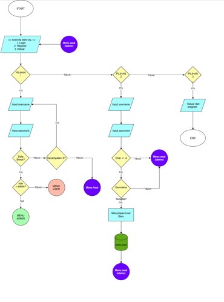

---

### B. Flowchart Dashboard Administrator
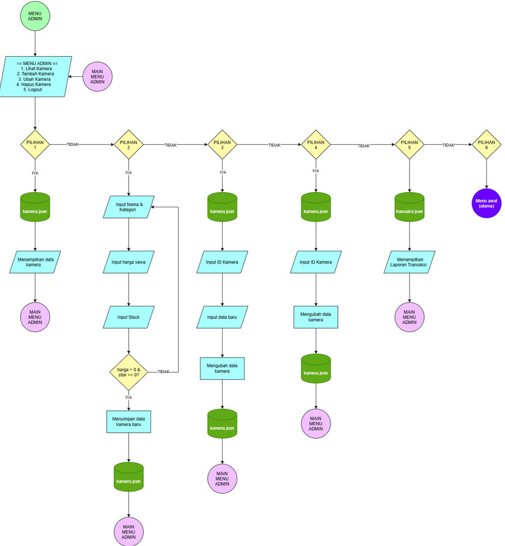

---

### C. Flowchart Dashboard User 

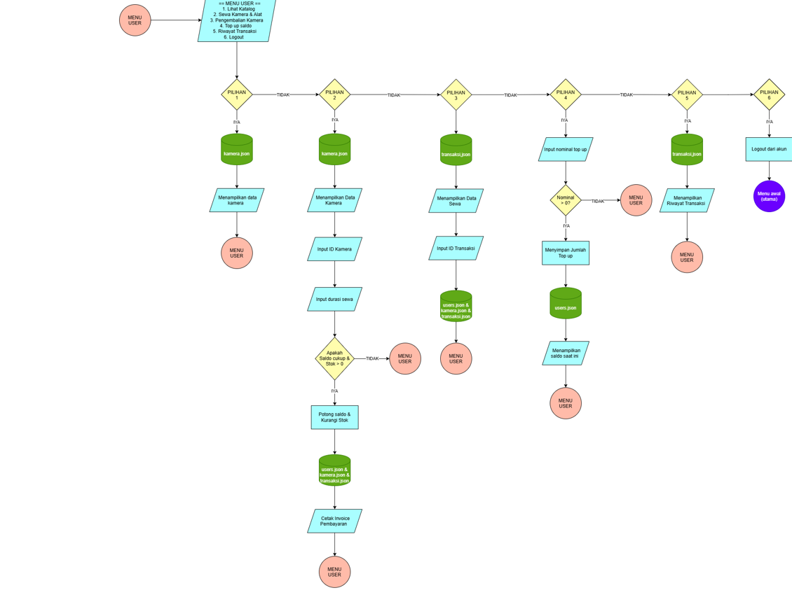

---

## 📋 5. Daftar Fitur per Role

Sistem Rental Kamera membagi hak akses pengguna ke dalam dua tingkatan peran (*role*), dengan fitur-fitur spesifik sebagai berikut:

### 🛡️ A. Role Administrator
Administrator memegang otoritas penuh terhadap tata kelola master data barang dan pengawasan keuangan toko:
1. **Autentikasi Admin Terproteksi**: Hak masuk ke dashboard khusus admin setelah verifikasi kredensial.
2. **Katalog Inventaris Lengkap (Read)**: Menampilkan seluruh daftar bodi kamera, lensa, stabilizer, dan lighting beserta status harga sewa dan jumlah stok menggunakan format tabel `PrettyTable` yang rapi.
3. **Registrasi Alat Baru (Create)**:
   * Menambahkan entri peralatan baru dengan ID unik (contoh: `CAM04`, `LNS02`, `STB02`).
   * Validasi keunikan ID alat agar tidak terjadi duplikasi data.
   * Validasi numerik: harga sewa harus bernilai $> 0$ dan stok awal tidak boleh bernilai negatif ($\ge 0$).
4. **Pembaruan Data Alat (Update)**:
   * Memperbarui informasi nama, kategori, harga sewa harian, maupun jumlah stok unit.
   * Fitur *in-place edit* (cukup tekan `Enter` jika atribut tertentu tidak ingin diubah).
5. **Penghapusan Data Alat (Delete)**:
   * Menghapus unit kamera yang sudah tidak disewakan lagi dengan konfirmasi keamanan (`y/n`).
   * **Proteksi Integritas Data Relasional**: Sistem secara otomatis menolak penghapusan unit barang jika barang tersebut sedang tercatat aktif berstatus `"Disewa"` oleh pelanggan di `transaksi.json`.
6. **Laporan Transaksi Global**:
   * Memantau seluruh rekam jejak sewa dari seluruh pelanggan yang terdaftar.
   * Mengetahui identitas penyewa, nama alat, total durasi, pendapatan total sewa, serta status sewa (`Disewa` atau `Selesai`).
7. **Cetak & Ekspor Invoice Transaksi**: Administrator dapat mencetak ulang struk transaksi pelanggan manapun dan mengekspornya ke berkas fisik `.txt`.

---

### 👤 B. Role User / Penyewa
Pengguna umum bertindak sebagai konsumen/penyewa alat dengan alur layanan mandiri (*self-service*):
1. **Registrasi Akun Baru**:
   * Pendaftaran akun mandiri dengan validasi panjang username minimal 4 karakter.
   * Pengecekan keunikan username (*case-insensitive*) agar tidak ada akun ganda.
   * Pembuatan dompet digital baru dengan saldo awal Rp 0 secara otomatis.
2. **Pengecekan Saldo E-Money Terintegrasi**: Informasi saldo terkini selalu ditampilkan pada *header* menu user secara *real-time*.
3. **Top Up Saldo E-Money**:
   * Pengisian saldo dompet digital mandiri.
   * Batas minimal pengisian sebesar Rp 10.000 dengan dialog konfirmasi (`y/n`).
4. **Katalog Kamera Siap Sewa (Read)**: Melihat daftar peralatan kamera, rincian harga sewa per hari, dan sisa stok unit yang tersedia.
5. **Penyewaan Alat Mandiri**:
   * Pemilihan alat berdasarkan ID kamera dan durasi sewa harian (minimal 1 hari).
   * Kalkulasi total tagihan otomatis: $\text{Total} = \text{Lama Hari} \times \text{Tarif Harian}$.
   * Validasi stok alat: transaksi ditolak jika unit habis ($stok \le 0$).
   * Validasi saldo otomatis: transaksi ditolak jika saldo tidak mencukupi, disertai informasi kekurangan dana dan anjuran Top Up.
   * Pemotongan saldo dan pengurangan stok unit seketika secara sinkron.
6. **Penerbitan Struk & Ekspor File Invoice Fisik**:
   * Penerbitan struk transaksi resmi dengan nomor invoice unik (contoh: `TRX001`).
   * Opsi ekspor struk otomatis ke file fisik berekstensi `.txt` di direktori `invoices/invoice_<ID>.txt`.
7. **Pengembalian Alat Sewa**:
   * Menampilkan daftar alat yang secara spesifik sedang disewa oleh pengguna terkait.
   * Pembaruan status transaksi menjadi `"Selesai"` dan pencatatan tanggal/jam pengembalian otomatis.
   * **Restok Otomatis**: Unit kamera yang dikembalikan otomatis bertambah kembali ($stok + 1$) pada katalog inventaris.
8. **Riwayat Transaksi Pribadi**: Meninjau seluruh transaksi sewa yang pernah dilakukan beserta opsi melihat kembali invoice digital kapan pun dibutuhkan.

---

### ⚙️ C. Keamanan & Utilitas Sistem Umum
1. **Penyembunyian Password (*Password Masking*)**: Menggunakan pustaka pihak ketiga `pwinput` sehingga karakter sandi tidak terlihat saat diketik di konsol.
2. **Sistem Penguncian Percobaan (*Lockout System*)**: Batasan maksimal 3 kali salah memasukkan kredensial saat login untuk mencegah teknik *brute-force*.
3. **Cross-Platform Screen Cleaning**: Pembersihan layar otomatis menggunakan perintah `cls` pada sistem operasi Windows dan `clear` pada Linux/macOS.
4. **Input Aman & Penanganan Interupsi (*Exception Handling*)**:
   * Penanganan `EOFError` saat tombol interupsi `CTRL+Z` ditekan pada sesi masukan, membatalkan aksi dengan pesan informatif tanpa merusak eksekusi program (*anti-crash*).
   * Penanganan `KeyboardInterrupt` saat tombol `CTRL+C` ditekan, menghentikan aplikasi secara aman (*graceful shutdown*).
   * Validasi tipe data angka (`ValueError`) pada masukan nominal harga, stok, hari, dan opsi menu.
5. **Fail-Safe JSON Engine**: Penyimpanan data terisolasi dalam modul `utils.py` yang secara aman menangani skenario file belum terbentuk, file korup, maupun direktori belum tersedia.

---

## 📂 6. Struktur Direktori Repositori

```text
SistemRentalKamera/
│
├── data/                            # Direktori database lokal berbasis JSON
│   ├── kamera.json                  # Master data katalog inventaris & stok alat
│   ├── transaksi.json               # Rekam jejak seluruh transaksi rental
│   └── users.json                   # Database kredensial pengguna, role, & saldo
│
├── invoices/                        # Direktori penyimpanan ekspor struk pembayaran (.txt)
│   └── invoice_DUMMY.txt    # Contoh struk transaksi sewa fisik
│
├── auth.py                          # Modul autentikasi: registrasi, login, lockout
├── kamera.py                        # Modul pengelolaan inventaris kamera (CRUD Admin)
├── main.py                          # File utama (entry point) dan navigasi menu sistem
├── transaksi.py                     # Modul bisnis sewa, pengembalian, top up, & invoice
├── utils.py                         # Modul utilitas: I/O JSON, clear screen, input aman
└── README.md                        # Dokumentasi utama proyek
```

---

## 🔑 7. Akun Pengujian (Default Accounts)

Untuk mempermudah demonstrasi dan pengujian sistem, berikut adalah akun bawaan yang telah tersedia pada `data/users.json`:

| Role | Username | Password | Saldo Awal | Hak Akses Utama |
| :---: | :---: | :---: | :---: | :--- |
| **Administrator** | `admin` | `admin123` | - | Akses penuh CRUD inventaris kamera, laporan transaksi global, dan cetak invoice. |
| **User (Penyewa 1)** | `user1` | `user1234` | Rp 100.000 | Akses sewa alat, pengembalian unit, top up saldo, dan riwayat transaksi pribadi. |
| **User (Penyewa 2)** | `user` | `user123` | Rp 250.000 | Akun pelanggan alternatif untuk pengujian multi-user dan transaksi serentak. |

---

## 💻 8. Panduan Instalasi & Menjalankan

### A. Prasyarat Sistem
* Python versi `3.8` atau versi yang lebih baru terpasang pada komputer Anda.
* Pengelola paket `pip` aktif.

### B. Langkah Menjalankan
1. **Clone Repositori**:
   ```bash
   git clone https://github.com/itsraizhu/SistemRentalKamera.git
   cd SistemRentalKamera
   ```

2. **Pasang Dependensi Library**:
   Aplikasi membutuhkan library `prettytable` untuk rendering tabel dan `pwinput` untuk penyembunyian password:
   ```bash
   pip install prettytable pwinput
   ```

3. **Jalankan Aplikasi Utama**:
   ```bash
   python main.py
   ```

---

## 🖥️ 9. Screenshot Output & Penjelasan

Berikut adalah dokumentasi tampilan antarmuka konsol (*CLI*) aplikasi pada setiap alur fungsional sistem beserta analisis penjelasan alur kerjanya:

---

### 1. Menu Utama Aplikasi

> *Simpan file tangkapan layar ke folder: `docs/screenshots/01_menu_utama.png`*  
> 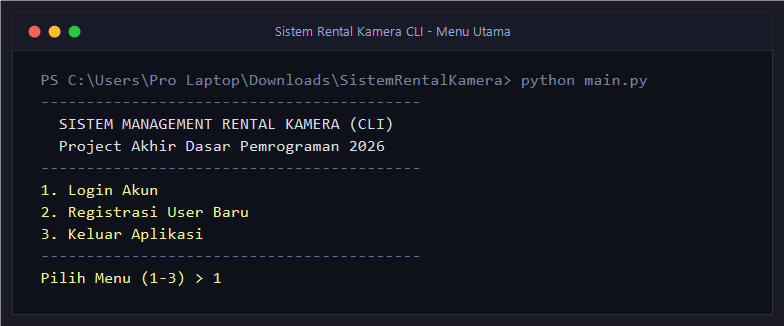

```text
------------------------------------------
  SISTEM MANAGEMENT RENTAL KAMERA (CLI)   
  Project Akhir Dasar Pemrograman 2026   
------------------------------------------
1. Login Akun
2. Registrasi User Baru
3. Keluar Aplikasi
------------------------------------------
Pilih Menu (1-3) > 
```

**Penjelasan**:
Layar ini merupakan gerbang awal (*entry point*) aplikasi yang dieksekusi dari fungsi `main()` pada `main.py`. Pengguna disambut dengan identitas proyek dan tiga opsi navigasi sederhana: login untuk pengguna yang telah terdaftar, registrasi bagi penyewa baru, dan opsi keluar untuk mengakhiri program.

---

### 2. Registrasi Akun Pengguna

> *Simpan file tangkapan layar ke folder: `docs/screenshots/02_registrasi.png`*  
> 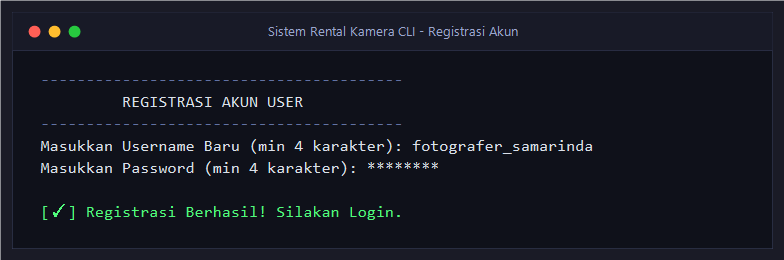

```text
----------------------------------------
         REGISTRASI AKUN USER           
----------------------------------------
Masukkan Username Baru (min 4 karakter): fotografer_samarinda
Masukkan Password (min 4 karakter): ••••••••

[✓] Registrasi Berhasil! Silakan Login.
```

**Penjelasan**:
Modul `auth.py` menangani pendaftaran akun baru. Sistem memvalidasi bahwa username minimal memiliki 4 karakter dan memastikan nama tersebut belum pernah terdaftar sebelumnya (*unique validation*). Password diketik dengan keamanan penyamaran titik (*masking*) melalui fungsi `pwinput`. Akun baru langsung diberi role `"user"` dengan saldo awal default Rp 0 dan dicatat ke `data/users.json`.

---

### 3. Login & Sistem Penguncian (Lockout)

> *Simpan file tangkapan layar ke folder: `docs/screenshots/03_login_lockout.png`*  
> 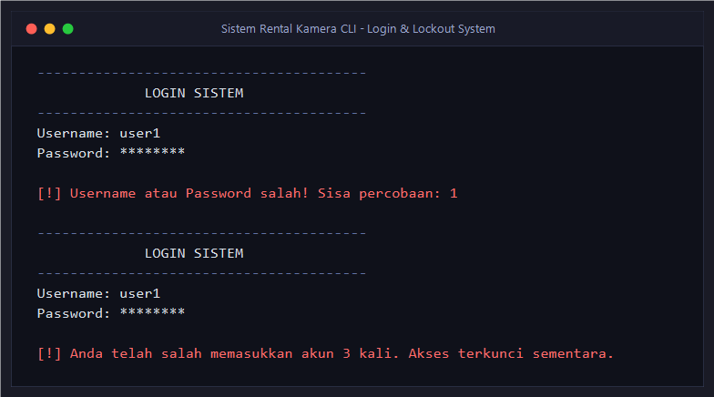

```text
----------------------------------------
             LOGIN SISTEM               
----------------------------------------
Username: user1
Password: ••••••••

[!] Username atau Password salah! Sisa percobaan: 2
```

*Jika salah memasukkan password sebanyak 3 kali berturut-turut:*

```text
----------------------------------------
             LOGIN SISTEM               
----------------------------------------
Username: user1
Password: ••••••••

[!] Anda telah salah memasukkan akun 3 kali. Akses terkunci sementara.
```

**Penjelasan**:
Fitur keamanan pada fungsi `login_user()` memproteksi sistem dari upaya pembobolan berulang kali (*brute force*). Setiap kali verifikasi kredensial gagal, sistem menghitung mundur sisa kesempatan pengguna. Jika gagal mencapai batas 3 kali, sesi input dikunci dan pengguna secara otomatis dikembalikan ke Menu Utama.

---

### 4. Dashboard Menu Administrator

> *Simpan file tangkapan layar ke folder: `docs/screenshots/04_menu_admin.png`*  
> 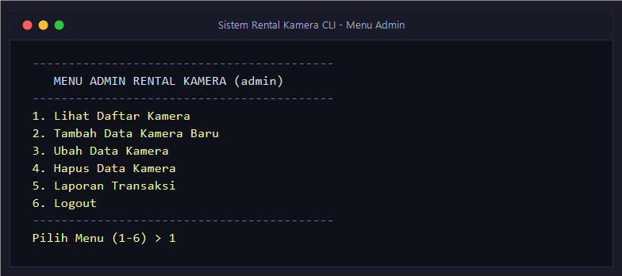

```text
------------------------------------------
   MENU ADMIN RENTAL KAMERA (admin)
------------------------------------------
1. Lihat Daftar Kamera
2. Tambah Data Kamera Baru
3. Ubah Data Kamera
4. Hapus Data Kamera
5. Laporan Transaksi
6. Logout
------------------------------------------
Pilih Menu (1-6) > 
```

**Penjelasan**:
Setelah berhasil diautentikasi dengan role `"admin"`, administrator diarahkan ke dashboard operasional (`menu_admin`). Dashboard ini menyediakan seluruh fitur esensial inventarisasi barang (CRUD), pengawasan rekapitulasi transaksi sewa seluruh pelanggan, dan opsi kembali/logout.

---

### 5. Katalog Inventaris Kamera (PrettyTable)

> *Simpan file tangkapan layar ke folder: `docs/screenshots/05_katalog_kamera.png`*  
> 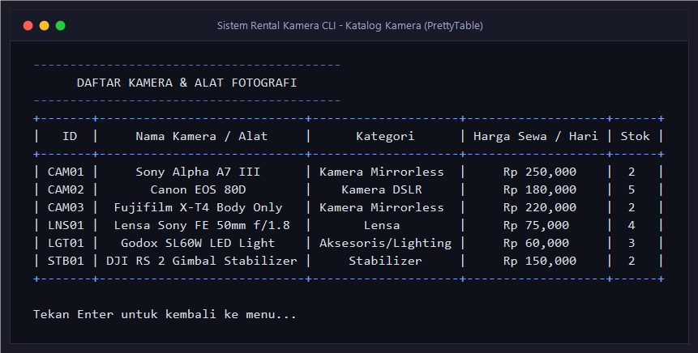

```text
------------------------------------------
      DAFTAR KAMERA & ALAT FOTOGRAFI      
------------------------------------------
+-------+----------------------------+--------------------+-------------------+------+
|   ID  |     Nama Kamera / Alat     |      Kategori      | Harga Sewa / Hari | Stok |
+-------+----------------------------+--------------------+-------------------+------+
| CAM01 |     Sony Alpha A7 III      | Kamera Mirrorless  |     Rp 250,000    |  2   |
| CAM02 |       Canon EOS 80D        |    Kamera DSLR     |     Rp 180,000    |  5   |
| CAM03 |  Fujifilm X-T4 Body Only   | Kamera Mirrorless  |     Rp 220,000    |  2   |
| LNS01 |  Lensa Sony FE 50mm f/1.8  |       Lensa        |     Rp 75,000     |  4   |
| LGT01 |   Godox SL60W LED Light    | Aksesoris/Lighting |     Rp 60,000     |  3   |
| STB01 | DJI RS 2 Gimbal Stabilizer |     Stabilizer     |     Rp 150,000    |  2   |
+-------+----------------------------+--------------------+-------------------+------+

Tekan Enter untuk kembali ke menu...
```

**Penjelasan**:
Fungsi `tampilkan_kamera()` pada modul `kamera.py` membaca `data/kamera.json` dan memformatnya menjadi tabel konsol yang rapi dengan pustaka `PrettyTable`. Tabel menampilkan ID unik alat, nama unit, kategori, tarif harian yang diformat mata uang Rupiah, serta jumlah unit yang tersedia (*ready stock*).

---

### 6. Tambah Kamera Baru (Create)

> *Simpan file tangkapan layar ke folder: `docs/screenshots/06_tambah_kamera.png`*  
> 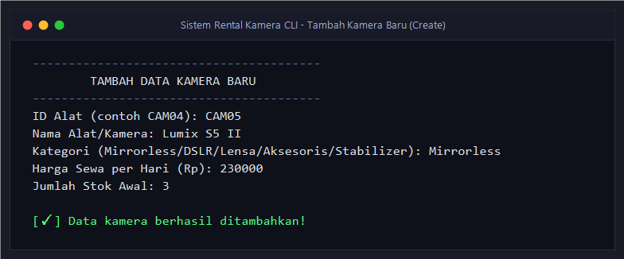

```text
----------------------------------------
        TAMBAH DATA KAMERA BARU         
----------------------------------------
ID Alat (contoh CAM04): CAM05
Nama Alat/Kamera: Lumix S5 II
Kategori (Mirrorless/DSLR/Lensa/Aksesoris/Stabilizer): Mirrorless
Harga Sewa per Hari (Rp): 230000
Jumlah Stok Awal: 3

[✓] Data kamera berhasil ditambahkan!
```

**Penjelasan**:
Fungsi `tambah_kamera()` memungkinkan admin memasukkan peralatan baru. Sistem memvalidasi keunikan ID alat agar tidak tumpang tindih dengan data lama, memastikan harga sewa bernilai positif ($> 0$), dan memastikan kuantitas stok tidak negatif. Data yang lolos validasi otomatis dipersistensikan ke `data/kamera.json`.

---

### 7. Ubah Data Kamera (Update)

> *Simpan file tangkapan layar ke folder: `docs/screenshots/07_ubah_kamera.png`*  
> 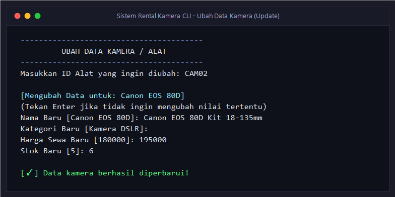

```text
----------------------------------------
         UBAH DATA KAMERA / ALAT        
----------------------------------------
[Tabel Daftar Kamera Ditampilkan...]

Masukkan ID Alat yang ingin diubah: CAM02

[Mengubah Data untuk: Canon EOS 80D]
(Tekan Enter jika tidak ingin mengubah nilai tertentu)
Nama Baru [Canon EOS 80D]: Canon EOS 80D Kit 18-135mm
Kategori Baru [Kamera DSLR]: 
Harga Sewa Baru [180000]: 195000
Stok Baru [5]: 6

[✓] Data kamera berhasil diperbarui!
```

**Penjelasan**:
Fungsi `ubah_kamera()` memberikan fleksibilitas bagi admin untuk memodifikasi informasi unit. Dengan konsep *interactive default*, admin cukup menekan `Enter` pada input atribut yang tidak ingin diganti, dan hanya mengetikkan nilai baru pada kolom yang hendak diubah (seperti penyesuaian harga sewa atau penambahan unit fisik baru).

---

### 8. Hapus Kamera & Proteksi Alat Sedang Disewa (Delete)

> *Simpan file tangkapan layar ke folder: `docs/screenshots/08_hapus_kamera.png`*  
> 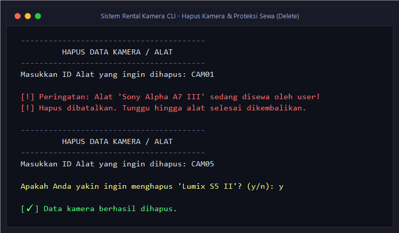

*Skenario 1: Percobaan menghapus alat yang sedang aktif disewa pelanggan:*

```text
----------------------------------------
         HAPUS DATA KAMERA / ALAT       
----------------------------------------
Masukkan ID Alat yang ingin dihapus: CAM01

[!] Peringatan: Alat 'Sony Alpha A7 III' sedang disewa oleh user!
[!] Hapus dibatalkan. Tunggu hingga alat selesai dikembalikan.
```

*Skenario 2: Penghapusan alat yang bebas sewa:*

```text
----------------------------------------
         HAPUS DATA KAMERA / ALAT       
----------------------------------------
Masukkan ID Alat yang ingin dihapus: CAM05

Apakah Anda yakin ingin menghapus 'Lumix S5 II'? (y/n): y

[✓] Data kamera berhasil dihapus.
```

**Penjelasan**:
Untuk menjaga konsistensi dan integritas data, fungsi `hapus_kamera()` memeriksa riwayat transaksi pada `data/transaksi.json`. Jika alat terkait masih tercatat dengan status `"Disewa"`, sistem memblokir tindakan penghapusan dengan peringatan tegas demi mencegah terjadinya *broken reference*. Penghapusan hanya diizinkan untuk alat yang tidak sedang berada di tangan penyewa.

---

### 9. Laporan Transaksi Admin

> *Simpan file tangkapan layar ke folder: `docs/screenshots/09_laporan_transaksi.png`*  
> 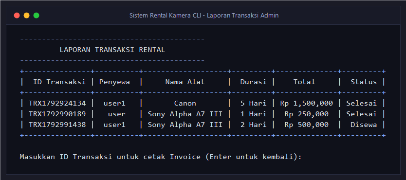

```text
------------------------------------------
         LAPORAN TRANSAKSI RENTAL         
------------------------------------------
+---------------+----------+-------------------+---------+--------------+---------+
|  ID Transaksi | Penyewa  |     Nama Alat     |  Durasi |    Total     |  Status |
+---------------+----------+-------------------+---------+--------------+---------+
| TRX1792924134 |  user1   |       Canon       |  5 Hari | Rp 1,500,000 | Selesai |
| TRX1792990189 |   user   | Sony Alpha A7 III |  1 Hari |  Rp 250,000  | Selesai |
| TRX1792991438 |  user1   | Sony Alpha A7 III |  2 Hari |  Rp 500,000  |  Disewa |
+---------------+----------+-------------------+---------+--------------+---------+

Masukkan ID Transaksi untuk cetak Invoice (Enter untuk kembali): 
```

**Penjelasan**:
Fungsi `riwayat_admin()` menampilkan rekapitulasi komprehensif seluruh aktivitas penyewaan. Admin dapat memantau status sewa (apakah alat masih di luar atau sudah kembali), mengecek perolehan omset sewa, serta dapat memasukkan ID Transaksi spesifik untuk mencetak ulang invoice transaksi.

---

### 10. Dashboard Menu User & Saldo Real-Time

> *Simpan file tangkapan layar ke folder: `docs/screenshots/10_menu_user.png`*  
> 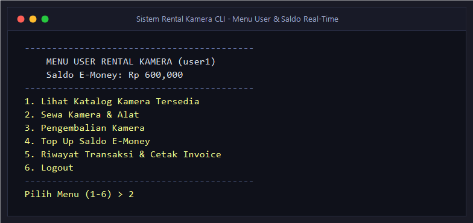

```text
------------------------------------------
    MENU USER RENTAL KAMERA (user1)
    Saldo E-Money: Rp 600,000
------------------------------------------
1. Lihat Katalog Kamera Tersedia
2. Sewa Kamera & Alat
3. Pengembalian Kamera
4. Top Up Saldo E-Money
5. Riwayat Transaksi & Cetak Invoice
6. Logout
------------------------------------------
Pilih Menu (1-6) > 
```

**Penjelasan**:
Menu pelanggan dirancang dengan pendekatan *user-friendly*. Setiap kali menu ini disegarkan, aplikasi membaca ulang file `data/users.json` sehingga nilai saldo dompet digital *E-Money* selalu sinkron dan akurat secara *real-time*.

---

### 11. Top Up Saldo E-Money

> *Simpan file tangkapan layar ke folder: `docs/screenshots/11_topup_saldo.png`*  
> 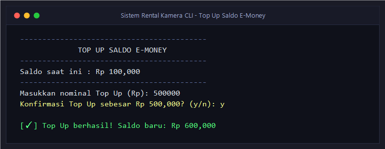

```text
------------------------------------------
             TOP UP SALDO E-MONEY         
------------------------------------------
Saldo saat ini : Rp 100,000
------------------------------------------
Masukkan nominal Top Up (Rp): 500000
Konfirmasi Top Up sebesar Rp 500,000? (y/n): y

[✓] Top Up berhasil! Saldo baru: Rp 600,000
```

**Penjelasan**:
Melalui fungsi `top_up_saldo()`, penyewa dapat mengisi saldo dompet digital mereka. Sistem menetapkan aturan validasi batas minimal pengisian sebesar Rp 10.000 dan meminta konfirmasi sebelum saldo ditambahkan ke akun pengguna secara permanen.

---

### 12. Transaksi Penyewaan Alat

> *Simpan file tangkapan layar ke folder: `docs/screenshots/12_sewa_kamera.png`*  
> 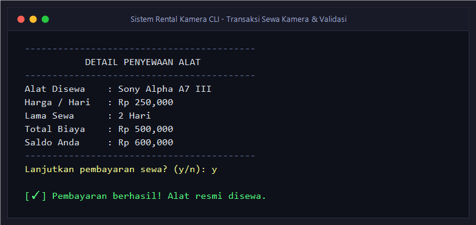

*Skenario: Pemilihan alat, durasi sewa, validasi saldo, dan pemotongan stok otomatis:*

```text
------------------------------------------
           DETAIL PENYEWAAN ALAT          
------------------------------------------
Alat Disewa    : Sony Alpha A7 III
Harga / Hari   : Rp 250,000
Lama Sewa      : 2 Hari
Total Biaya    : Rp 500,000
Saldo Anda     : Rp 600,000
------------------------------------------
Lanjutkan pembayaran sewa? (y/n): y

[✓] Pembayaran berhasil! Alat resmi disewa.
```

*Jika saldo tidak mencukupi:*

```text
------------------------------------------
           DETAIL PENYEWAAN ALAT          
------------------------------------------
Alat Disewa    : Sony Alpha A7 III
Harga / Hari   : Rp 250,000
Lama Sewa      : 3 Hari
Total Biaya    : Rp 750,000
Saldo Anda     : Rp 600,000
------------------------------------------

[!] Saldo tidak mencukupi! Kurang Rp 150,000
[!] Silakan lakukan Top Up saldo terlebih dahulu.
```

**Penjelasan**:
Fungsi `sewa_kamera()` melakukan serangkaian verifikasi ketat sebelum transaksi disahkan:
1. Memeriksa ketersediaan unit ($stok > 0$).
2. Menghitung total biaya: $Total = Lama \times Tarif$.
3. Memastikan saldo pelanggan $\ge Total Biaya$. Jika kurang, sistem menolak dan mengarahkan pengguna melakukan Top Up.
4. Jika disetujui, saldo langsung dipotong, stok kamera di database berkurang 1 unit, dan data transaksi baru diterbitkan dengan status `"Disewa"`.

---

### 13. Cetak & Ekspor Struk/Invoice (.txt)

> *Simpan file tangkapan layar ke folder: `docs/screenshots/13_invoice.png`*  
> 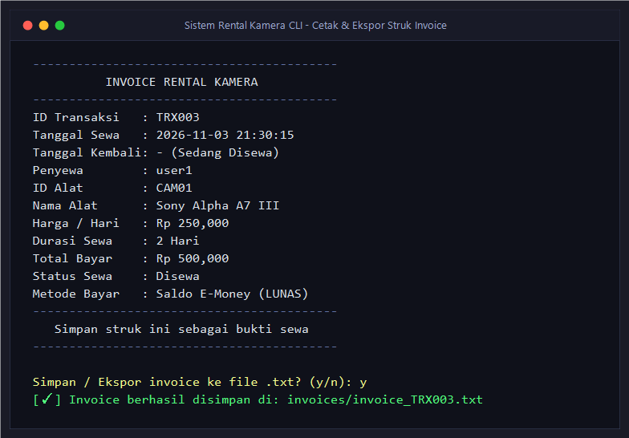

```text
------------------------------------------
          INVOICE RENTAL KAMERA           
------------------------------------------
ID Transaksi   : TRX003
Tanggal Sewa   : 2026-11-03 21:30:15
Tanggal Kembali: - (Sedang Disewa)
Penyewa        : user1
ID Alat        : CAM01
Nama Alat      : Sony Alpha A7 III
Harga / Hari   : Rp 250,000
Durasi Sewa    : 2 Hari
Total Bayar    : Rp 500,000
Status Sewa    : Disewa
Metode Bayar   : Saldo E-Money (LUNAS)
------------------------------------------
   Simpan struk ini sebagai bukti sewa    
------------------------------------------

Simpan / Ekspor invoice ke file .txt? (y/n): y
[✓] Invoice berhasil disimpan di: invoices/invoice_TRX003.txt
```

*Contoh isi fisik berkas `invoices/invoice_TRX003.txt`:*

```text
==========================================
          INVOICE RENTAL KAMERA           
==========================================
ID Transaksi   : TRX003
Tanggal Sewa   : 2026-11-03 21:30:15
Tanggal Kembali: - (Sedang Disewa)
Penyewa        : user1
ID Alat        : CAM01
Nama Alat      : Sony Alpha A7 III
Harga / Hari   : Rp 250,000
Durasi Sewa    : 2 Hari
Total Bayar    : Rp 500,000
Status Sewa    : Disewa
Metode Bayar   : Saldo E-Money (LUNAS)
==========================================
   Terima kasih telah menyewa kamera!     
==========================================
```

**Penjelasan**:
Fungsi `cetak_invoice()` dan `simpan_invoice_txt()` menerbitkan bukti pembayaran sah. Pengguna diberikan opsi untuk mengekspor struk digital ini menjadi file teks fisik (`.txt`) di dalam folder `invoices/` sebagai arsip resmi bukti pengambilan alat.

---

### 14. Pengembalian Alat Sewa & Restok Otomatis

> *Simpan file tangkapan layar ke folder: `docs/screenshots/14_pengembalian.png`*  
> 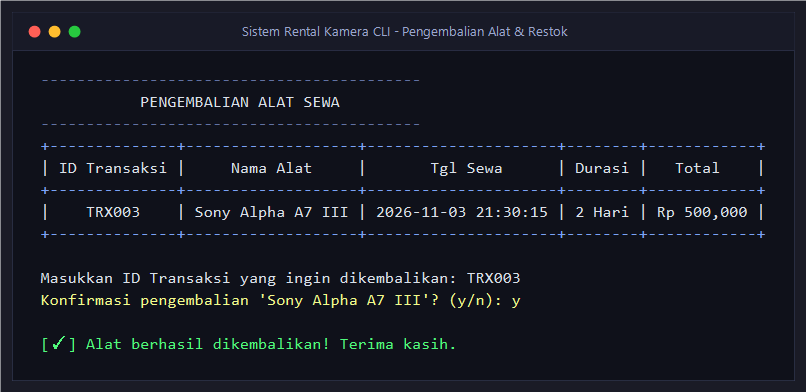

```text
------------------------------------------
           PENGEMBALIAN ALAT SEWA         
------------------------------------------
+--------------+-------------------+---------------------+--------+------------+
| ID Transaksi |     Nama Alat     |       Tgl Sewa      | Durasi |   Total    |
+--------------+-------------------+---------------------+--------+------------+
|    TRX003    | Sony Alpha A7 III | 2026-11-03 21:30:15 | 2 Hari | Rp 500,000 |
+--------------+-------------------+---------------------+--------+------------+

Masukkan ID Transaksi yang ingin dikembalikan: TRX003
Konfirmasi pengembalian 'Sony Alpha A7 III'? (y/n): y

[✓] Alat berhasil dikembalikan! Terima kasih.
```

**Penjelasan**:
Fungsi `pengembalian_kamera()` menyaring data sewa aktif milik pengguna yang sedang login. Setelah pengguna mengonfirmasi pengembalian, sistem melakukan dua tindakan serentak:
1. Mengubah status transaksi menjadi `"Selesai"` dan mencatat waktu pengembalian aktual (`YYYY-MM-DD HH:MM:SS`).
2. Menambahkan kembali jumlah unit kamera ($stok + 1$) pada file `data/kamera.json` sehingga alat langsung tersedia kembali untuk penyewa berikutnya.

---

### 15. Riwayat Transaksi User

> *Simpan file tangkapan layar ke folder: `docs/screenshots/15_riwayat_user.png`*  
> 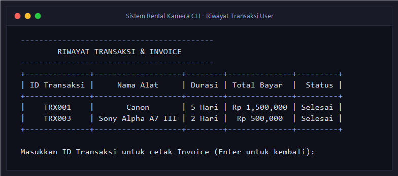

```text
------------------------------------------
        RIWAYAT TRANSAKSI & INVOICE       
------------------------------------------
+--------------+-------------------+--------+-------------+---------+
| ID Transaksi |     Nama Alat     | Durasi | Total Bayar |  Status |
+--------------+-------------------+--------+-------------+---------+
|    TRX001    |       Canon       | 5 Hari | Rp1,500,000 | Selesai |
|    TRX003    | Sony Alpha A7 III | 2 Hari |  Rp 500,000 | Selesai |
+--------------+-------------------+--------+-------------+---------+

Masukkan ID Transaksi untuk cetak Invoice (Enter untuk kembali): 
```

**Penjelasan**:
Fungsi `riwayat_user()` memberikan transparansi bagi pelanggan untuk memantau seluruh riwayat transaksi yang pernah mereka lakukan lengkap dengan durasi, nominal biaya, status penyewaan, serta opsi melihat kembali rincian struk invoice kapan saja.

---

### 16. Penanganan Interupsi Aman (CTRL+C & CTRL+Z)

> *Simpan file tangkapan layar ke folder: `docs/screenshots/16_penanganan_error.png`*  
> 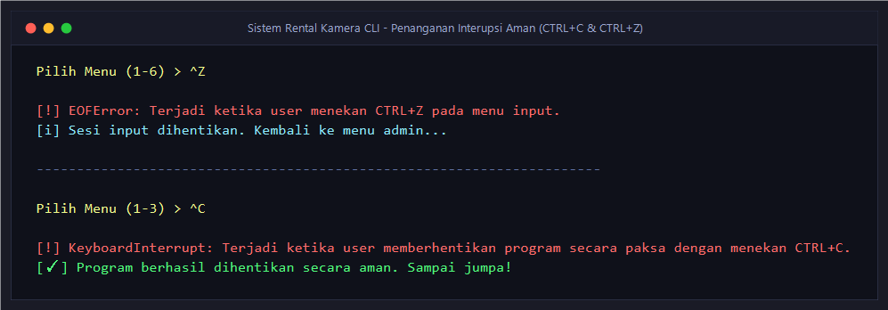

*Skenario Interupsi Input Keyboard (CTRL+Z pada Windows / EOFError):*

```text
Pilih Menu (1-6) > ^Z

[!] EOFError: Terjadi ketika user menekan CTRL+Z pada menu input.
[i] Sesi input dihentikan. Kembali ke menu admin...
```

*Skenario Penghentian Paksa Program (CTRL+C / KeyboardInterrupt):*

```text
^C
[!] KeyboardInterrupt: Terjadi ketika user memberhentikan program secara paksa dengan menekan CTRL+C.
[✓] Program berhasil dihentikan secara aman. Sampai jumpa!
```

**Penjelasan**:
Sistem dilengkapi dengan penanganan eksepsi tingkat lanjut (`try-except` pada `input_aman()` di `utils.py` dan blok pelindung di `main.py`). Jika pengguna secara sengaja atau tidak sengaja menekan kombinasi tombol pembatal terminal seperti `CTRL+Z` atau `CTRL+C`, aplikasi tidak akan menampilkan *error traceback* yang merusak tampilan konsol, melainkan menangkapnya secara anggun (*graceful handling*) dan menjaga integritas file JSON.

---
